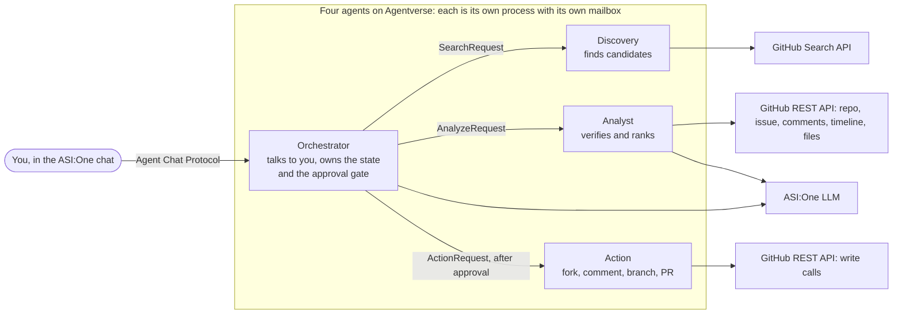
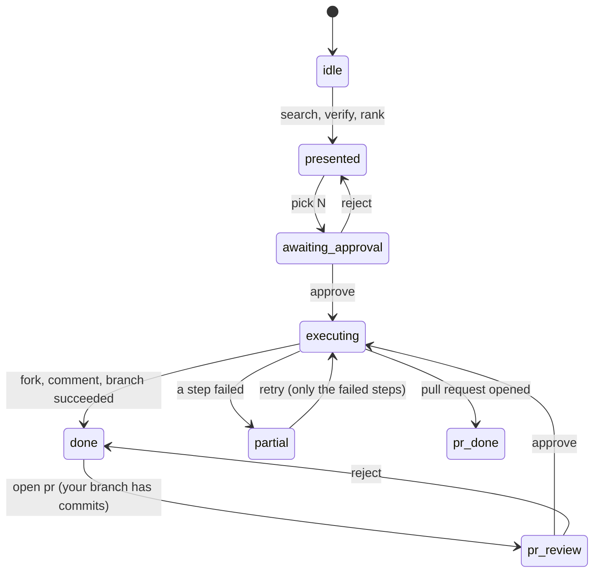

# Open-Source Contribution Copilot

**Turn "I want to contribute to open source" into a verified issue, a claimed fork and a starter branch, without leaving the ASI:One chat.**


Built for the **ASI:One Agent Challenge: From Intent to Action**. Four cooperating [uAgents](https://github.com/fetchai/uAgents) are registered on Agentverse and discoverable through ASI:One. You talk to one of them in plain language; the others search GitHub, verify every candidate live, and, **only after you approve**, fork, comment and branch on your behalf.

> **Demo data is seeded.** The repository used for live GitHub writes, [`nitinsk0920/copilot-demo-calc`](https://github.com/nitinsk0920/copilot-demo-calc), was set up by hand for this demo, and its issues are seeded, not organic. For every *other* repository the agent runs in **dry-run mode**: it shows exactly what it would do and writes nothing. See [Demo mode and dry runs](#demo-mode-and-dry-runs).

## Contents

[The problem](#the-problem) · [What it does](#what-it-does) · [A conversation](#a-conversation) · [Architecture](#architecture) · [How verification works](#how-verification-works) · [Safety model](#safety-model) · [Try it in ASI:One](#try-it-in-asione) · [Run it yourself](#run-it-yourself) · [Demo mode and dry runs](#demo-mode-and-dry-runs) · [Testing](#testing) · [Design notes](#design-notes) · [Limitations and roadmap](#limitations-and-roadmap) · [Hackathon checklist](#hackathon-checklist) · [Project layout](#project-layout)

## The problem

Beginners want a first open-source contribution (for a resume, GSoC or Hacktoberfest) and rarely finish one:

1. Searching "good first issue" returns thousands of results, and many are **dead**: an inactive repo, an issue someone already claimed, a PR already open, a task mislabeled as easy.
2. They can't tell whether an issue fits their **skills and time**.
3. They stall on **setup**: reading the contribution rules, forking, branching, writing a polite claim comment.

**Target users:** students and early-career developers.
**Outcome:** a short list of *live-verified* issues matched to you; after your approval a fork, a claim comment and a starter branch; a personalised plan with the exact commands; and, once you have pushed your own fix, an optional pull request, again only after you approve.

## What it does

| Step | What happens | Who acts |
|---|---|---|
| 1. Understand | Reads your languages, level and time budget from free text (asks if a language is missing) | Orchestrator (`asi1-mini`) |
| 2. Search | Finds about 20 open, unassigned, recently updated "good first issue" candidates | Discovery |
| 3. Verify | Checks every candidate **live** and drops the dead ones, with the reason | Analyst |
| 4. Rank | Picks the top 5 for *your* skills and time, with a one-sentence reason each | Analyst (`asi1`) |
| 5. Review | Shows exactly what will happen: the fork, the comment text, the branch name, LIVE or DRY RUN | Orchestrator |
| 6. Act | **After you approve:** forks, posts the claim comment, creates the starter branch | Action |
| 7. Plan | Writes a plan: clone, branch, install and test, files to edit, sign-off, PR link | Orchestrator |
| 8. Pull request | **After you push your own fix and approve:** checks your branch, opens the PR | Action |

You do four things: ask, pick, approve, then code.

### Why this is more than a chatbot with web search

- **Live verification.** An ordinary assistant can *find* issues. This one checks last-push date, claim comments, open PRs, issue state and the repo's contribution rules before showing anything, and tells you what it filtered out and why.
- **Real side effects, with a gate.** Fork, comment, branch and pull request happen on GitHub, behind an explicit approval and a repo allowlist.
- **Multi-agent orchestration.** Four agents with their own Agentverse profiles and typed messages between them.
- **Recovery.** Too few survivors, or none: it widens the search once; still nothing: it tells you what to relax. A failed step is reported by name and `retry` repeats only that step.
- **It follows the repo's own rules.** If `CONTRIBUTING.md` asks for a branch named `fix/issue-<number>`, the starter branch is named that way; the PR description starts from the repo's PR template.

## A conversation

An abridged example against the seeded demo repository. The wording is the agent's real output; the numbers and the
ranking vary from run to run.

```text
You    I'm a beginner, I know Python, I have about a weekend, I'd like to add input validation to a small calculator

Copilot  Looking for open beginner issues for beginner python ~10 h...
         Found 20 candidates. Checking each one live (repo activity, claim comments, open PRs, contribution rules)...
         I checked 20 candidates live for **beginner python ~10 h**. 16 survived; here are the top 5:

         4. **nitinsk0920/copilot-demo-calc** #1: Add input validation to divide() in calc.py
            Why: Tiny, precisely scoped Python change plus one test; ideal confidence-builder well within budget.
            Verified live: repo active (last push today), issue open and unassigned, no claim comments,
                           no open PR referencing it, CONTRIBUTING.md found
         ...
         Filtered out (4 of 20):
         - nitinsk0920/copilot-demo-calc #6: not in English (Japanese)
         - nitinsk0920/copilot-demo-calc #4: already claimed: @nitinsk0920 asked to work on it today
         - nitinsk0920/copilot-demo-calc #5: open pull request #8 already references this issue

You    pick 4

Copilot  **Review: this is exactly what I will do. Nothing has been changed yet.**
         LIVE: this repo is on the demo allowlist, so approving will really write to GitHub.
         1. Fork `nitinsk0920/copilot-demo-calc` into your GitHub account
         2. Post this comment on the issue:
            > Hi! I'd like to work on this issue. I'll read CONTRIBUTING.md first and open a pull request once it's ready. ...
         3. Create branch `fix/issue-1` in your fork, from `main` (named as CONTRIBUTING.md asks)
         [ Approve ]  [ Reject ]                                  <- tappable card, or type "approve" / "reject"

You    approve

Copilot  Results:
         - fork: done, fork is Nitinsk20/copilot-demo-calc
         - comment: done, claim comment posted
         - branch: done, branch `fix/issue-1` created in Nitinsk20/copilot-demo-calc
         # Contribution plan: nitinsk0920/copilot-demo-calc #1 ...

        (you fix the bug and push it to your branch)

You    open pr

Copilot  Checking `fix/issue-1` for your changes...
         Your changes: branch `fix/issue-1` is 1 commit(s) ahead of `main`, changing: calc.py, test_calc.py
         Title: Add input validation to divide() in calc.py   Description: ... Fixes #1
         [ Open pull request ]  [ Cancel ]
```

## Architecture



- **Orchestrator** is the only agent you talk to. It parses your intent, keeps one conversation state machine per user, sends text and cards, and is the only place an approval is created.
- **Discovery** runs one GitHub search per language and merges the results into a diverse list (at most two issues per repo).
- **Analyst** filters non-English issues, runs the live checks in small concurrent batches, then asks the LLM to rank the survivors. It treats issue text as untrusted data.
- **Action** is the only agent that writes to GitHub. It accepts requests **only from the Orchestrator**.

Each agent is a separate process (`scripts/run_all.py` starts all four) with its own seed, port and Agentverse mailbox, so each has its own profile URL. Messages between agents are typed `uagents` models (`SearchRequest`, `AnalyzeResponse`, `ActionRequest`, ...) in [`models.py`](src/copilot/models.py).

### Conversation state



## How verification works

Every candidate is checked **live** against GitHub before you see it. Thresholds are deliberately lenient, so small beginner-friendly repos survive; there is no minimum star count.

| Check | Drops the issue when... | Example reason shown to you |
|---|---|---|
| Repo state | archived, disabled, issues turned off, or no push in 180 days | `repository looks inactive (last push 240 days ago)` |
| Issue state | closed, locked, or already assigned | `already assigned to @amy` |
| Claim comments | a human comment in the last 60 days says "can I work on this?", "I'll take it", "assign me" (older claims are kept with a heads-up) | `already claimed: @bob asked to work on it 2 days ago` |
| Open pull request | a cross-referencing PR is still open | `open pull request #8 already references this issue` |
| Language | the issue is not in English (script and stop-word heuristics) | `not in English (Japanese)` |
| Anything unverifiable | GitHub errors, or the issue vanished | `could not be verified right now` (never shown as safe) |

For survivors it also reads the repo's contribution rules: the CONTRIBUTING file (CLA, sign-off, "ask first", tests, **branch naming**), the PR template, and the top-level file list (to suggest install and test commands and to match file names the issue mentions to files that really exist).

**Recovery.** If fewer than 3 issues survive, or the search returns nothing, the Orchestrator asks Discovery for one wider pass (more labels such as `help wanted` and `beginner`, issues up to 180 days old), merges the survivors and tells you it did so. If that also fails, it says what to relax.

## Safety model

Nothing is written to GitHub without your explicit approval, and several independent layers back that up:

| Layer | What it guarantees |
|---|---|
| Approval gate | An approval id is created in exactly one place, when *you* approve. The Action agent refuses write steps without one. |
| Whole-message commands | `approve` (also `yes`, `go ahead`) must be the entire message. "yes please find me a Rust issue" is a new search, never an approval. |
| Allowlist | While `DEMO_MODE=true`, live writes happen only on repositories in `ALLOWED_TARGET_REPOS`. Everything else is a dry run. |
| Sender check | The Action agent ignores any sender except the Orchestrator; the Orchestrator ignores responses from anyone but the agent it asked. |
| Stale-button protection | Every card button carries a reference to exactly what it showed (issue, comment, branch, PR text). An old Approve button cannot approve a different issue or an edited comment. Platform-added fields such as `"approved": true` are never trusted. |
| Idempotent retries | The claim comment carries a hidden marker so a retry cannot post it twice; an existing fork or branch counts as success; a branch never gets a second PR. |
| Untrusted input | Issue titles and bodies go into LLM prompts as data to judge, never as instructions. Prompt-injection text inside an issue is ignored. |
| Secrets | Tokens live in `.env` (git-ignored), are read from the environment, and are never logged. |
| No code, no merge | The agent never writes your fix and never merges anything. |

## Try it in ASI:One

Open the Orchestrator's Agentverse profile and click **Chat with Agent**, or start a chat on [asi1.ai](https://asi1.ai) and mention it by address:

```text
@agent1q04874jq9r26j0snfv24rzeaawwk002q97g32f3jnyh6rwjzp0mc70c2fhz I'm a beginner, I know Python, I have about a weekend
```

| Agent | Address | Agentverse profile |
|---|---|---|
| **Orchestrator** `oss-contribution-copilot` (talk to this one) | `agent1q04874jq9r26j0snfv24rzeaawwk002q97g32f3jnyh6rwjzp0mc70c2fhz` | [Agentverse profile](https://agentverse.ai/agents/details/agent1q04874jq9r26j0snfv24rzeaawwk002q97g32f3jnyh6rwjzp0mc70c2fhz/profile) |
| Discovery `oss-copilot-discovery` | `agent1qtywj6p4vtg68ndzm2cyfq779tjtkx2jgue2hz8ug4fmqzmz4swpzz7kd9j` | [Agentverse profile](https://agentverse.ai/agents/details/agent1qtywj6p4vtg68ndzm2cyfq779tjtkx2jgue2hz8ug4fmqzmz4swpzz7kd9j/profile) |
| Analyst `oss-copilot-analyst` | `agent1qt8s8vged7qz0u8q7s2ztvlq5dqnnssw4zdxz9njfxuzqs0uxjqpzsch0jf` | [Agentverse profile](https://agentverse.ai/agents/details/agent1qt8s8vged7qz0u8q7s2ztvlq5dqnnssw4zdxz9njfxuzqs0uxjqpzsch0jf/profile) |
| Action `oss-copilot-action` | `agent1qfxfyku3ukgt25qaassxnhwzqrlvz3e2c4elve680766ztuxft4v7mgl9wq` | [Agentverse profile](https://agentverse.ai/agents/details/agent1qfxfyku3ukgt25qaassxnhwzqrlvz3e2c4elve680766ztuxft4v7mgl9wq/profile) |

Every step is also available as plain text, and every card button has a typed equivalent:

| You type | What it does |
|---|---|
| a request, e.g. `I know Python and Go, a few hours` | search, verify and rank |
| `pick 2` (or tap **Pick this one**) | review that issue: the fork, comment and branch it will create |
| `approve` / `reject` (or tap the buttons) | run it, or cancel. Only `approve` writes to GitHub. |
| `edit comment: <text>` | change the claim comment before approving |
| `retry` | repeat only the steps that failed |
| `cards` | show the issue picker as a card carousel |
| `open pr` | after you pushed your fix: check the branch and review the pull request |
| `edit pr: <text>` | write your own PR description (`Fixes #N` is added for you) |
| `help` | the introduction |

The first reply arrives in about 3 seconds. The ranked list takes roughly **20 to 40 seconds** (live checks on about 20 issues plus LLM ranking; a repeated search is faster because GitHub answers are cached for 5 minutes), and progress messages are sent meanwhile. `pick`, the review and `approve` take a few seconds.

**Submission links:** [ASI:One shared chat](https://asi1.ai/chat/0568f642-5da5-4108-86bc-377b7434e928) · [Demo video](https://drive.google.com/file/d/1HMStGF6FJYLrJuEOCbjW59YOYn8XYKGx/view?usp=sharing)

## Run it yourself

**You need:** Python 3.10+ (developed on 3.12), an [Agentverse](https://agentverse.ai) account, an [ASI:One](https://asi1.ai) API key, a **throwaway GitHub account** with a classic personal access token (`public_repo`), and a public **test repository on a different GitHub account** (a repo cannot be forked by its owner).

```bash
python -m venv .venv
.venv/Scripts/activate            # Windows;  source .venv/bin/activate  on Linux/macOS
pip install -r requirements.txt && pip install -e .
cp .env.example .env              # fill it in (table below)
python scripts/run_all.py         # starts all four agents
```

On the first run each agent prints an **Inspector link**. Open it, click **Connect, then Mailbox**, and accept the code. This is needed once per agent; the mailbox belongs to the agent's address, so it survives restarts. Then fill in each agent's profile on Agentverse (name, description, starter prompts); the README text for each agent is in [`agent_profiles/`](agent_profiles/).

### Environment variables

Values live only in `.env` (git-ignored). Names, as in [`.env.example`](.env.example):

| Variable | Purpose |
|---|---|
| `ORCHESTRATOR_SEED_PHRASE`, `DISCOVERY_SEED_PHRASE`, `ANALYST_SEED_PHRASE`, `ACTION_SEED_PHRASE` | One long random string per agent. Fixes its address and mailbox. Keep secret and never change. |
| `ASI1_API_KEY` | ASI:One LLM. Optional: without it the agents fall back to keyword parsing and freshness ordering. |
| `GITHUB_TOKEN` | Throwaway-account PAT (`public_repo`) for searching, verifying and approved writes. |
| `DEMO_MODE`, `ALLOWED_TARGET_REPOS` | Write safety; see [Demo mode and dry runs](#demo-mode-and-dry-runs). |
| `*_PORT` (optional) | Agent ports, default 8000 to 8003. |
| `LLM_FAST_MODEL`, `LLM_MAIN_MODEL` (optional) | Default `asi1-mini` (parsing) and `asi1` (ranking). |
| `*_ADDRESS` (optional) | Use an explicit agent address instead of deriving it from the seed. |
| `LOCAL_ONLY` (optional) | Run without mailboxes, for local development and end-to-end tests only. |

To run it headless on a server (restart on crash, clean shutdown, systemd/Windows/Docker notes) see [DEPLOY.md](DEPLOY.md).

## Demo mode and dry runs

Real writes are controlled by two settings: `DEMO_MODE=true` (the default) and `ALLOWED_TARGET_REPOS=owner/repo[,owner/repo]`.

- **Allowlisted repo:** the review says **LIVE** and `approve` really forks, comments, branches (and later opens the PR).
- **Any other repo:** the review says **DRY RUN**. `approve` lists what *would* happen (`would do: fork ...`), sends nothing to GitHub, and you still get the full plan. Real maintainers are never touched.
- Discovery always includes the allowlisted repo's issues in the search (when its language matches your request), so the seeded scenarios are reachable.

### The seeded demo repository

[`nitinsk0920/copilot-demo-calc`](https://github.com/nitinsk0920/copilot-demo-calc) is a tiny Python calculator whose `CONTRIBUTING.md` asks for a branch `fix/issue-<number>`, signed-off commits and `pytest`. Its seven issues each show one behaviour:

| # | Issue | What the agent does |
|---|---|---|
| 1 | Add input validation to `divide()` | clean and easy: the live-write demo |
| 2 | Fix typo in the README quick-start | clean and trivial |
| 3 | Add a `modulo()` function with tests | clean, a bit more work |
| 4 | Support the exponent operator | **filtered:** already claimed (a real "Can I work on this?" comment) |
| 5 | Handle empty input | **filtered:** an open pull request already references it |
| 6 | バグ修正: `divide()` のゼロ除算を処理する | **filtered:** not in English |
| 7 | Rewrite the parser as a compiler | labeled "good first issue" but huge: ranks low |

A live run claims the issue, so it is filtered next time; delete the claim comment to repeat a demo.

## Testing

```bash
pip install -r requirements-dev.txt
pytest                                       # 113 unit tests, no network or keys needed
python scripts/local_e2e.py                  # all four agents + a scripted user, DRY RUN, throwaway seeds
E2E_SCENARIO=cards python scripts/local_e2e.py   # also plays card clicks, including a stale Approve and the PR flow
python scripts/local_e2e.py owner/repo       # that repo is allowlisted: REAL fork, comment, branch
python scripts/local_e2e.py --running        # one read-only search through your RUNNING agents and mailboxes
```

`local_e2e.py` uses throwaway seeds and different ports, so it never touches your real agents or their registrations. The unit tests mock HTTP and the LLM and cover the retry and rate-limit layer, the GitHub client, every verification check, ranking validation, language detection, command parsing (approvals only match whole messages), the Action agent's safety rules and idempotency, the card payloads, and the plan writer.

The whole workflow has run live through ASI:One against the demo repository: search, verification, ranking, fork, claim comment, branch, and, after the contributor pushed a fix, the pull request itself ([PR #13](https://github.com/nitinsk0920/copilot-demo-calc/pull/13)). The pull-request step is also covered by unit tests, a read-only check against live GitHub (branch with and without commits, existing PR, missing branch) and an end-to-end dry run through the real agents.

## Design notes

- **Four standalone agents, not a `Bureau`.** A Bureau would run them in one process with in-process messaging (about 1 ms), but the Agentverse Inspector cannot connect a mailbox for Bureau-hosted agents. Standalone agents each get a mailbox and their own profile. The cost is some extra delay per hop, which is small next to the 20 to 40 seconds a search takes (GitHub checks and LLM ranking dominate).
- **Cards are an add-on, text is the source of truth.** The text of every step is always sent first; the carousel and the Approve/Reject cards follow. If a card does not render, nothing is lost. ASI:One returns a card click as the selection JSON (plus keys of its own), which the command parser maps to the same commands you could type.
- **Resilience over cleverness.** All external calls go through one retry layer (timeouts, backoff, rate-limit waits, 5xx and network errors). GitHub searches are spaced by a second and verification runs in batches of four, because GitHub's secondary rate limit punishes bursts. Empty search results are a valid answer, not an error.
- **LLM output is validated, never trusted.** JSON mode plus a repair retry, hallucinated issue numbers are dropped, scores are clamped, and a heuristic ranking takes over if the model fails.
- **One seam for GitHub identity.** All GitHub access goes through `get_github_token(user_id)` in [`github_auth.py`](src/copilot/tools/github_auth.py).
- The original project brief is kept in [`docs/PROJECT_BRIEF.md`](docs/PROJECT_BRIEF.md) as a design record.

## Limitations and roadmap

- **One shared GitHub token.** Fine for a hackathon; every user's fork and comment would come from the same account. A real product would use per-user **GitHub OAuth**. Because all access goes through `get_github_token(user_id)`, switching means changing only that function.
- **Heuristics, not guarantees.** Claim detection is phrase matching and non-English detection is script and stop-word based; both can miss or misfire. Verification is a snapshot, so re-check the issue before you start.
- **Latency.** The ranked list takes roughly 20 to 40 seconds per search (measured 19 to 38 seconds in real ASI:One runs), dominated by the live checks and the LLM ranking.
- **Agents must be running.** With mailboxes, messages queue while the process is down and are handled when it returns.
- **Tested on Windows 11** with Python 3.12 and `uagents` 0.26.1.
- **Not built (roadmap):** follow-up monitoring (notify when the maintainer replies), the Payment Protocol for a premium tier, per-user OAuth, and a persistent database for session state (today: memory plus a JSON file).

## Hackathon checklist

| Requirement | Status |
|---|---|
| At least one agent registered on Agentverse | Four |
| Agent Chat Protocol | Yes, all four agents |
| Discoverable and usable through ASI:One | Orchestrator (the other three are internal workers) |
| Meaningful tool execution and multi-agent orchestration | GitHub search, live verification, fork, comment, branch and pull request, LLM parsing and ranking |
| Whole workflow inside ASI:One, no custom frontend | Yes |
| Public repository with run and test instructions | This file, plus [DEPLOY.md](DEPLOY.md) |
| Bonus: multi-agent collaboration | Yes, typed messages between four agents |
| Bonus: ASI Interactive Cards | Issue carousel and Approve/Reject cards for the review and the PR, each with a typed fallback |
| Bonus: reliability and recovery | Retries, rate-limit handling, widening search, per-step retry |
| Bonus: real-time data | Live GitHub state on every search |
| Bonus: Payment Protocol | Not implemented |
| Bonus: keeps operating after the hackathon | Headless supervisor with restart and clean shutdown ([DEPLOY.md](DEPLOY.md)); no follow-up monitoring yet |

## Project layout

```text
src/copilot/
  agents/    orchestrator.py  discovery.py  analyst.py  action.py
  logic/     verification.py  ranking.py  language.py  intent.py  commands.py  review.py  query_builder.py  selection.py
  tools/     github_client.py  github_auth.py  http.py  llm_client.py  plan_writer.py
  models.py  messages between agents + domain models
  cards.py   formatting.py   chat.py   state.py   config.py   main.py
agent_profiles/    the README text shown on each agent's Agentverse profile
scripts/           run_all.py (supervisor)   local_e2e.py (end-to-end harness)
tests/             113 unit tests
docs/PROJECT_BRIEF.md   the original project brief, kept as a design record
DEPLOY.md          running it headless on a server
```

Built with [uAgents](https://github.com/fetchai/uAgents), the Agent Chat Protocol, Agentverse and the ASI:One LLM API.
